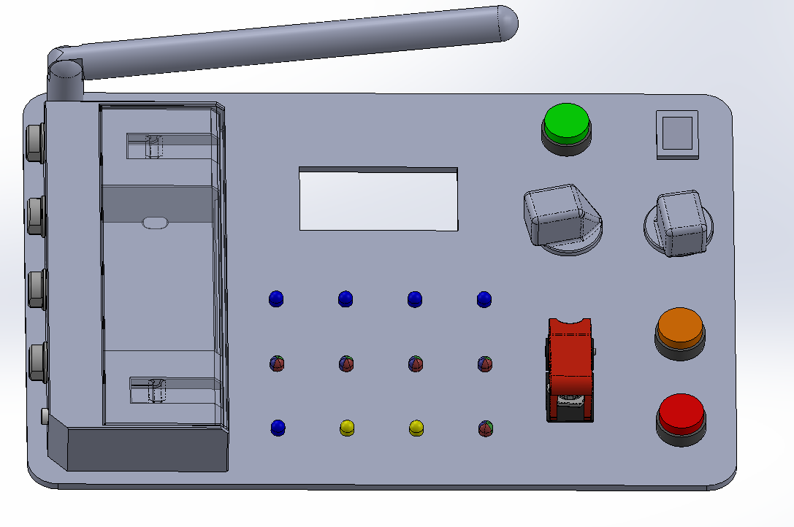

# Remote Ignition System 26 Manual
# 遙控點火系統26型（點火器）說明書

## 日期：2026/10/21  
**負責人**：龍昊（甲方）、林冠宏（乙方）

---

# 摘要
本手冊說明遙控點火系統26型（RIS26）之設計與操作。系統由兩套相同手提箱組成，分為控制端與點火端，支援雙箱遙控、單箱直接點火及WiFi控制三種模式。硬體架構涵蓋電源管理（2S鋰電池與降壓模組）、四路繼電器點火線路、DAQ介面、LoRa長距離通訊天線，以及以NodeMCU32為核心的主控板，搭配按鈕、LED、OLED與蜂鳴器等控制指示介面。

---

# 目錄
1. 簡介與操作方式
2. 系統架構
3. 面板與外殼
4. 控制、指示元件與通訊天線
5. 點火線路與DAQ介面
6. 電源
7. 微控制器
8. 韌體

---

# 1. 簡介與操作方式
點火器包含兩個相同的手提箱。

* **GitHub 專案庫**：[linkkwisteria-droid/remote-ignition-system-26](https://github.com/linkkwisteria-droid/remote-ignition-system-26)

### 操作模式（共四種）：
1. **點火端**  
   搭配另一個使用**遙控端**模式的裝置，使用遙控端控制點火端。
2. **遙控端**
    搭配另一個使用**點火端**模式的裝置，使用遙控端控制點火端。
3. **遙控+點火**  
   僅使用單一手提箱，開啟後切換至直接點火模式即可操作。
4. **WiFi**  
   開啟手提箱切換至 WiFi 模式，使用手機連線控制。WiFi 密碼設計為隨機生成（每次開機不同），將顯示於 OLED 螢幕上。

---

# 2. 系統架構
系統主要由電源、點火線路、控制、指示、DAQ、天線以及微控制器與電路組成的主電路板構成。系統分為點火端與遙控端兩套，由模式切換開關決定角色。

---

# 3. 面板與外殼

## 3.1 面板
* **設計與組裝**：由龍昊負責面板上方使用者介面設計，並製作主電路板、電源及點火線路。後續根據模組尺寸設計面板固定位置與螺絲孔位。面板預留埋線凹槽，線材埋入後以絕緣膠帶固定。

## 3.2 外殼
* 配備兩款規格相同的防護手提箱。
* **參考連結**：[手提箱連結](https://shopee.tw/%F0%9F%94%A5%E5%8F%B0%E7%81%A3%E7%8F%BE%E8%B2%A8-%E5%84%AA%E8%B3%AA%E5%8A%A0%E5%8E%9A%E6%AC%BE-%E5%B7%A5%E5%85%B7%E7%AE%B1-%E9%98%B2%E6%BD%AE%E7%AE%B1-%E5%A1%91%E8%86%A0%E7%AE%B1-%E6%89%8B%E6%8F%90%E6%94%B6%E7%B4%8D%E7%9B%92-%E6%89%8B%E6%8F%90%E7%AE%B1-%E9%98%B2%E6%B0%B4%E7%AE%B1-%E9%9B%BB%E5%8B%95%E5%B7%A5%E5%85%B7%E7%AE%B1-%E7%A1%AC%E6%AE%BC%E6%94%B6%E7%B4%8D%E7%9B%92-%E5%B7%A5%E4%BD%9C%E7%AE%B1-%E9%98%B2%E6%92%9E%E7%AE%B1-i.968422763.40723287826)

---

# 4. 控制、指示元件與通訊天線

## 4.1 控制元件表

| 元件代號 | 元件名稱 | 功能說明 | 型號 | 原理圖標籤（控制-MCU介面） |
| :--- | :--- | :--- | :--- | :--- |
| `SW_SPST_POWER` | 電源開關 | 控制系統電源 | 洛克船型開關 | `POWER_SWITCH`、`BATT` |
| `SW_SPDT_ARM` | 保險開關 | 點火端與控制端皆解除保險後方可點火；壓下護蓋自動關閉 | 搖頭開關加護蓋 | `GND(3.3V)`、`CTRL_ARM` |
| `SW_SPST_IGNITION` | 點火按鈕 | 解除保險後方可按壓進行點火 | 無段按鈕開關加護蓋 | `CTRL_ARM`、`CTRL_IGNITION` |
| `SW_SPST_COUNT` | 倒數按鈕 | 按下後蜂鳴器每秒響一次，`LED_IGNITION` 每秒紅黑交替 | 無段按鈕開關 | `GND(3.3V)`、`CTRL_COUNT` |
| `SW_SP4T_MODE` | 四段模式旋鈕 | 切換模式：遙控、點火、混合、WiFi。透過電阻分壓由 MCU ADC 讀取以節省腳位 | 四波段旋鈕 | `GND(3.3V)`、`MODE_CONSOLE`、`MODE_IGNITER`、`MODE_DUAL`、`MODE_WIFI` |
| `SW_SP4T_CHAN` | 通道切換開關 | 四段通道選擇 | 搖頭開關（回彈型） | `GND(3.3V)`、`CHAN_1`～`CHAN_4` |
| `SW_SPST_CHECK` | 自檢按鈕 | 按下後執行系統自檢程序（指示元件測試、控制元件腳位測試、MCU 內部狀態與錯誤碼顯示、DAQ 輸出） | 無段按鈕開關 | `GND(3.3V)`、`CHECK_BUTTON` |

## 4.2 指示元件表
| 元件代號 | 元件名稱 | 功能說明 | 型號 | 原理圖標籤（控制-MCU介面） |
| :--- | :--- | :--- | :--- | :--- |
| `LED_POWER` | 電源 LED | 開機時常亮 | 綠色 LED | `3.3V`、`GND` |
| `LED_MODE_CONSOLE` | 遙控模式 LED | 遙控模式時亮起 | 藍色 LED | `LED_MODE_CONSOLE`、`GND` |
| `LED_MODE_IGNITER` | 點火模式 LED | 點火模式時亮起 | 藍色 LED | `LED_MODE_IGNITER`、`GND` |
| `LED_MODE_DUAL` | 混合模式 LED | 混合模式時亮起 | 藍色 LED | `LED_MODE_DUAL`、`GND` |
| `LED_MODE_WIFI` | WiFi 模式 LED | WiFi 模式時亮起 | 藍色 LED | `LED_MODE_WIFI`、`GND` |
| `LED_CHAN_1` ~ `4` | 通道 1-4 LED | 指示通道狀態（使用中：黃/紅；待命中：綠/黑） | 多色 LED | `LED_CHAN_X_R/G/B`、`GND` |
| `LED_COMM` | 連線狀態 LED | 通訊連線時亮起 | 藍色 LED | `LED_COMM`、`GND` |
| `LED_ARM_CONSOLE` | 遙控保險 LED | 遙控端保險解除時亮起 | 黃色 LED | `LED_ARM_CONSOLE`、`GND` |
| `LED_ARM_IGNITER` | 點火保險 LED | 點火端保險解除時亮起 | 黃色 LED | `LED_ARM_IGNITER`、`GND` |
| `LED_IGNITION` | 倒數點火 LED | 倒數時紅黑交替（半亮）；點火線路導通時亮紅燈（全亮） | 紅色 LED | `LED_IGNITION`、`GND` |
| `OLED` | OLED 螢幕 | 顯示開機 Logo、兩端電量、連線品質（RSSI、掉包率）、錯誤碼及自檢資訊 | 2.42 吋 OLED | `OLED_SDA`、`OLED_SCL`、`3.3V`、`GND` |
| `BUZZER` | 蜂鳴器 | 提供開機音樂、按鈕回饋音、連線/斷線警報、保險解除警示滴滴聲、倒數提示音及點火高頻聲 | 無源電磁式蜂鳴器 | `5V`、`BUZZER`、`GND` |

## 4.3 通訊天線
* **模組**：RYLR993_Lite LoRa 模組（UART 介面）。
* **天線配置**：面板上設有 IPX 至 SMA 轉接座，連接 195mm SMA 膠棒天線。

| 模組接腳 | I/O | 說明 | 原理圖標籤（模組-MCU介面） |
| :--- | :--- | :--- | :--- |
| `VDD` | I | 電源輸入 | `3.3V_LORA` |
| `NRST` | I | 低電位重置輸入 | `LORA_NRST` |
| `RXD` | I | UART 資料輸入 | `LORA_RX` |
| `TXD` | O | UART 資料輸出 | `LORA_TX` |
| `GND` | - | 接地 | `GND` |

---

# 5. 點火線路與 DAQ 介面

## 5.1 點火線路
以 4 路繼電器模組為核心，4 個 MCU 輸入控制繼電器，4 個狀態輸出返回 MCU。
* **點火頭特性**：未燃燒約 1Ω，燃燒後升至數十 KΩ 至數百 KΩ。點火電流需達到 1A 以上。

| 原理圖標籤（點火模組-MCU介面） | I/O | 說明 |
| :--- | :--- | :--- |
| `BATT` | I | 點火電源 |
| `5V` | I | 繼電器電源 |
| `GND` | - | 接地 |
| `CHAN_1_IGNITION` ~ `4` | I | 通道 1~4 點火控制 |
| `CHAN_1_STATUS` ~ `4` | O | 通道 1~4 點火頭狀態回傳 |

## 5.2 DAQ 介面
規劃將點火觸發訊號分接至外部 DAQ 介面以提升即時性，需評估二極體防逆流及光耦隔離（避免與 DAQ 共地）之架構。

| 原理圖標籤 | 說明 |
| :--- | :--- |
| `DAQ` | 訊號輸出至 DAQ |
| `GND` | 接地 |

---

# 6. 電源
使用 2S 18650 鋰電池搭配保護板與保險絲，由電源開關控制。經降壓模組輸出 `5V`（供開發板及繼電器）與 `3.3V_LORA`（專供 LoRa 模組）。NodeMCU32 開發板內建 LDO 供晶片使用。

| 原理圖標籤 | 說明 |
| :--- | :--- |
| `BATT` | 未降壓（用於電量測量與點火） |
| `5V` | 5V 電源 |
| `3.3V` | 開發板輸出 3.3V |
| `3.3V_LORA` | LoRa 專用 3.3V |
| `GND` | 接地 |

---

# 7. 微控制器
主控採用 NodeMCU32，經排針固定於主電路板上。由於 GPIO 腳位不足，擴充採用 GPIO Expander 與 PWM Expander。

---

# 8. 韌體
規劃採用 FreeRTOS 架構開發（評估使用 Arduino IDE 或 ESP-IDF）。
